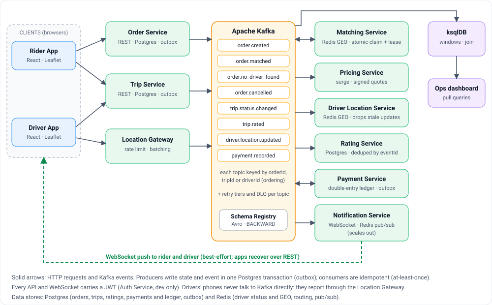

# grab-mini

[](https://github.com/nguyenchuongbep1310/grab-mini/actions/workflows/ci.yml)
[](LICENSE)

A ride-hailing backend in Go built around Apache Kafka, with a React design system and three apps on top. It exists to work through the hard parts of an event-driven system for real: ordering, duplicates, failure handling, schema evolution and what breaks under load.



## What it demonstrates

- **Event-driven services on Kafka.** Order, Matching, Trip, Pricing, Payment, Rating, Driver Location and Notification services communicate only through Avro events. ksqlDB reads the same topics for live analytics.
- **No lost or phantom events.** State and event are committed in one Postgres transaction (transactional outbox); every consumer is idempotent, so at-least-once delivery is safe.
- **No double-booked drivers.** Matching claims a driver with one atomic Redis script and a lease that expires if the matcher dies.
- **Money done carefully.** Payment Service settles each ride in a double-entry ledger: entries must sum to zero (checked in code and by a database trigger), amounts are integers, and a charge is unique per trip and kind, so a replay or crash never charges twice.
- **Failure handling.** Retry topics (5 s, 1 min, 10 min), dead-letter topics, permanent errors that skip retries, and a redrive tool for operators.
- **Evolvable contracts.** Avro in Schema Registry with `BACKWARD` compatibility; three schema versions shipped without breaking consumers.
- **Operable.** Prometheus alerts with a runbook, Grafana and Loki, traces carried through the outbox and Kafka, Kubernetes manifests with KEDA autoscaling, ACLs, and a disaster-recovery guide.
- **A shared design system.** One component library (`packages/ui`) used by the Rider, Driver and Ops apps.

## Measured, with its limits

Measured on **one 4-core laptop** that also ran every service, Kafka, Postgres and Redis (see [performance](docs/performance.md)):

| | Result |
|---|---|
| Orders matched at 250 orders/s | 100%, matching latency p99 0.1 s |
| Location consumer | ~2,300 → ~5,000 msg/s after batching commits |
| Synchronous publish (acks=all) | 1.001 s → 10.8 ms after fixing the writer batch timeout |
| Redis GEO search, 1M drivers, 3 km radius | ~90 queries/s per core (the real cost to plan for) |

At 400 orders/s the machine saturated before Matching did. The design targets (500 orders/s, 25,000 location updates/s) have **not** been verified on real infrastructure; [scaling.md](docs/scaling.md) says what I expect to break first at 10x and how I would check.

## Quick start

Needs Docker Desktop, Go 1.26+, Node 24 and pnpm 9.

```bash
pnpm install
pnpm dev:all
```

This starts the infrastructure, seeds five drivers, runs every service and opens the apps (Rider on `localhost:5171`, Driver on `localhost:5172/?driver=driver-1`, Ops on `localhost:5173`, Kafka UI on `localhost:8080`). The [developer guide](docs/guide.md) walks through taking a ride and watching it in Kafka.

## Where to read next

| If you want | Read |
|---|---|
| Why it is built this way, and what each choice costs | [Architecture decision records](docs/adr/README.md) |
| What breaks at 10x | [docs/scaling.md](docs/scaling.md) |
| What was measured and found | [docs/performance.md](docs/performance.md) |
| Run it, explore it, API and Makefile reference | [docs/guide.md](docs/guide.md) |
| Operate it: alerts and procedures | [docs/runbook.md](docs/runbook.md), [docs/disaster-recovery.md](docs/disaster-recovery.md) |
| Requirements, design and task history (spec-driven) | [specs/ride-booking-mini](specs/ride-booking-mini) |
| Production design and its known gaps | [production-design.md](specs/ride-booking-mini/production-design.md) |

## Honest limits

It is a learning and portfolio project, not a product. Tokens are Ed25519 JWTs verified through a JWKS, but the issuer is a development token service, not a real identity provider. Rides are settled through a double-entry ledger against a sandbox payment provider: no real card processor, payouts, refunds or reconciliation. Kubernetes manifests (including Redis/Sentinel, backups, retention and network policies), Sentinel and ACL configuration are tested in pieces (scripts and client behaviour against real Redis/Postgres/Kafka, manifests schema-checked) but the full stack has not been run on a real cluster. Single region only.

## License

[MIT](LICENSE)
